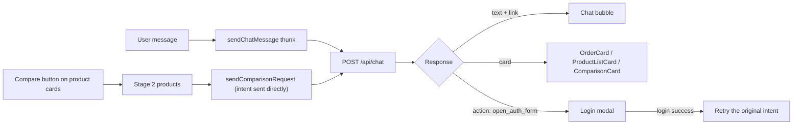

# 🛒 MERN E-Commerce Frontend — with an AI Shopping Assistant

A full-featured e-commerce storefront and admin panel built with **Next.js 16 (App Router)**, **React 19**, **TypeScript**, **Redux Toolkit**, and **Tailwind CSS**. It includes an **AI chat assistant** that answers product questions, checks order status, and compares products side by side.

🎬 [Watch the Video Walkthrough](https://youtu.be/gIIgdMW259Q) | 🌐 [Live Demo](https://mern-ecommerce-frontend-jg1w.onrender.com/) | ⚙️ [Backend Repository](https://github.com/mHasan1037/mern-ecommerce-backend)

> The live demo runs on free-tier hosting, so the first request after a period of inactivity can take up to a minute while the server wakes up.

---

## 📋 Table of Contents

- [Highlights](#highlights)
- [AI Shopping Assistant](#-ai-shopping-assistant)
- [Customer Features](#-customer-features)
- [How a Customer Places an Order](#-how-a-customer-places-an-order)
- [Admin Features](#-admin-features)
- [Tech Stack](#tech-stack)
- [Architecture Notes](#architecture-notes)
- [Project Structure](#project-structure)
- [Getting Started](#getting-started)
- [Environment Variables](#environment-variables)
- [Available Scripts](#available-scripts)
- [Deployment](#deployment)
- [Author](#author)

---

## Highlights

- 🤖 **AI chat assistant** (LangGraph + LangChain + Groq on the backend) for product search, order status, and product comparison, rendered as rich in-chat cards
- 🔐 **Cookie-based JWT authentication** with email OTP verification, password reset, and protected admin routes
- 💳 **Two payment options**: Cash on Delivery and online payment through SSLCommerz
- 🛍️ **Complete shopping flow**: browse, search, filter, wishlist, cart, checkout, order tracking
- 📊 **Admin dashboard** with revenue, order and user growth stats, low-stock alerts, and a full order-status workflow
- 🧩 **Admin tooling**: product and category CRUD, Cloudinary image uploads, drag-and-drop category ordering, unsaved-changes protection
- 📱 **Responsive UI** built with Tailwind CSS

---

## 🤖 AI Shopping Assistant

A floating **AI** button on every page opens a chat window. The frontend sends messages to the backend `/api/chat` endpoint, where the intent is classified and handled. The backend uses LangGraph, LangChain, and the Groq API. The frontend renders each reply as text plus an optional typed **card**.

| Capability | Example | What the user sees |
| --- | --- | --- |
| **Product query** | "Show me running shoes under 3000" | A product list card with image, price, and a link to each product |
| **Order query** | "Where is my last order?" | An order card with status, total, placed date, and items |
| **Product comparison** | Pick two products with the **Compare** button, then tap *Compare* | A side-by-side table of price, category, rating, and stock |

**How it works on the frontend**



- **Typed card responses.** Replies use a TypeScript discriminated union (`OrderCard | ProductListCard | ComparisonCard`), so each card type is rendered by its own component with full type safety.
- **Auth-gated intents.** Order queries need a logged-in user. If the user is not logged in, the assistant returns an `open_auth_form` action, the app opens the login modal, and the original request is **retried automatically after login**.
- **Button-driven comparison.** Users stage two products from any product card or product page. The comparison request is sent directly with the product IDs, which skips the intent classifier for a faster and more reliable result.
- **Dedicated Redux slice** (`aiChatSlice`) manages messages, loading and error state, and the comparison staging area.

---

## 👤 Customer Features

- **Accounts**: sign up with **email OTP verification**, log in, log out, reset a forgotten password via an emailed link, and change password from the account page
- **Browse and discover**: home page with a hero section, featured products, and most-sold products, plus a category sidebar (accordion on mobile)
- **Search and filter**: debounced live search, category filter, price range, sorting, and server-side pagination
- **Product details**: image gallery, price, stock status, ratings, and customer reviews
- **Reviews and ratings**: logged-in users can rate and review products
- **Wishlist**: save and remove favourite products
- **Cart**: add items, change quantities, remove items, clear the cart
- **Checkout**: pay for the whole cart, or use **Buy Now** for a single product
- **Orders**: order confirmation page, full order history, and order details
- **Profile**: personal info plus stats such as total amount ordered, delivered and cancelled orders, and most recent order

## 🧾 How a Customer Places an Order

1. **Sign up / log in.** Create an account and verify the email with an OTP.
2. **Find products.** Search, filter by category or price, or ask the AI assistant.
3. **Add to cart** (or click **Buy Now** on a product page to check out one item directly).
4. **Review the cart.** Adjust quantities or remove items.
5. **Checkout.** Enter shipping details (name, address, city, post code, phone).
6. **Choose a payment method:**
   - **Cash on Delivery (COD)**: the order is placed immediately.
   - **Online payment (SSLCommerz)**: the user is redirected to the payment gateway and returned to the app with a success, failed, or cancelled status.
7. **Order confirmation.** The user lands on an order success page.
8. **Track the order.** Check status in *My Orders* (processing → shipped → delivered) or just ask the AI assistant: *"What's the status of my order?"*

---

## 🛠️ Admin Features

Admin routes are protected: only users with admin rights can open `/admin`, and everyone else is redirected to the home page.

- **📊 Dashboard**: total orders, users, revenue, and products, with month-over-month growth indicators and a **low-stock products** alert list
- **📦 Product management**
  - Create, edit, and delete products
  - Upload and remove multiple images via **Cloudinary**
  - Mark products as **featured**
  - Paginated product list with search and status filtering
  - **Unsaved-changes guard**: warns before leaving a form and cleans up images uploaded but never saved
- **🗂️ Category management**
  - Create, edit, and delete categories with images
  - **Drag-and-drop reordering** of categories (`@hello-pangea/dnd`)
  - Safe deletion: products in a deleted category are reassigned first
- **🧾 Order management**
  - Paginated list of all orders with colour-coded status
  - Order details with customer, shipping address, payment method, and items
  - Status workflow enforced in the UI: `processing → shipped → delivered`, with `cancelled` allowed before delivery. Delivered and cancelled orders are locked.
- **👥 User insights**: view a customer's profile with total spent, delivered and cancelled order counts, and most recent order

---

## Tech Stack

| Category | Technology |
| --- | --- |
| Framework | [Next.js 16](https://nextjs.org/) (App Router, Turbopack) |
| UI Library | React 19 |
| Language | TypeScript |
| State Management | Redux Toolkit + React-Redux (slices for auth, cart, wishlist, products, categories, orders, UI, AI chat) |
| Styling | Tailwind CSS 3, CSS Modules |
| HTTP Client | Axios (shared instance with credentials enabled) |
| Image Hosting | Cloudinary (`next-cloudinary`) |
| Drag & Drop | `@hello-pangea/dnd` |
| Payments | SSLCommerz (online) + Cash on Delivery |
| Notifications | React Toastify |
| Icons | React Icons |
| Linting | ESLint |
| **AI (backend)** | LangGraph, LangChain, Groq API |

---

## Architecture Notes

- **Redux Toolkit with async thunks** keeps API access in one place per domain (`redux/slices/*`).
- **Auth** uses JWT access and refresh tokens stored in **httpOnly cookies**. Axios sends credentials on every request, and the app restores the session on load through a `loadUser` thunk.
- **Server-side pagination and filtering** are used on product and order lists, so large catalogs stay fast.
- **Custom hooks**: `useDebounce` for live search, `useOutsideClick` for dropdowns and modals, `useUnsavedChanges` for form safety.
- **Strongly typed API contracts** live in `types/`, including the chat card union types.

---

## Project Structure

```
mern-ecommerce-frontend/
├── app/                  # Next.js App Router — pages and layouts
│   ├── account/          # Profile, order history, order success, password pages
│   ├── admin/            # Dashboard, products, categories, orders, users
│   ├── cart/ checkout/   # Cart and checkout flow (COD + SSLCommerz)
│   ├── products/         # Product details
│   └── wishlist/
├── components/           # Reusable UI (AiChatBox, AiChatBubble, ProductBox, forms, admin UI…)
├── hooks/                # useDebounce-style utilities, useOutsideClick, useUnsavedChanges
├── providers/            # Redux provider
├── redux/                # Store and slices (auth, cart, wishlist, product, category, order, ui, aiChat)
├── types/                # TypeScript type definitions
├── utils/                # Axios instance and helpers
├── public/               # Static assets
├── next.config.ts        # Next.js config (Cloudinary image domain)
├── tailwind.config.ts
└── tsconfig.json
```

---

## Getting Started

### Prerequisites

- **Node.js** v18 or higher
- **npm**, **yarn**, **pnpm**, or **bun**
- A running instance of the [MERN E-Commerce Backend](https://github.com/mHasan1037/mern-ecommerce-backend) (it provides the REST API, authentication, payments, and the AI chat endpoint)

### Installation

1. **Clone the repository**

```bash
git clone https://github.com/mHasan1037/mern-ecommerce-frontend.git
cd mern-ecommerce-frontend
```

2. **Install dependencies**

```bash
npm install
```

3. **Set up environment variables** (see below)

4. **Run the development server**

```bash
npm run dev
```

Open <http://localhost:3000> in your browser.

---

## Environment Variables

Create a `.env.local` file in the project root:

```env
# Base URL of the backend API (no trailing slash)
NEXT_PUBLIC_API_BASE_URL=<your_backend_api_url>

# Cloudinary (used for admin image uploads)
NEXT_PUBLIC_CLOUDINARY_CLOUD_NAME=<your_cloudinary_cloud_name>
NEXT_PUBLIC_CLOUDINARY_UPLOAD_PRESET=<your_unsigned_upload_preset>
```

> **Note:** Never commit your `.env.local` file to version control.

---

## Available Scripts

| Script | Description |
| --- | --- |
| `npm run dev` | Start the development server with Turbopack |
| `npm run build` | Build for production |
| `npm run start` | Start the production server |
| `npm run lint` | Run ESLint |

---

## Deployment

The live demo is hosted on **Render**. The project can also be deployed to **Vercel**:

1. Push the repository to GitHub.
2. Import the project in [Vercel](https://vercel.com/) (or create a Web Service on Render).
3. Add the environment variables listed above.
4. Deploy.

The backend is a separate service: see the [backend repository](https://github.com/mHasan1037/mern-ecommerce-backend).

---

## Author

**Mahmudul Hasan** — Full-Stack Developer

- GitHub: [@mHasan1037](https://github.com/mHasan1037)
- LinkedIn: [linkedin.com/in/mhasan95](https://linkedin.com/in/mhasan95)
- Email: mhasan.bd.95@gmail.com
